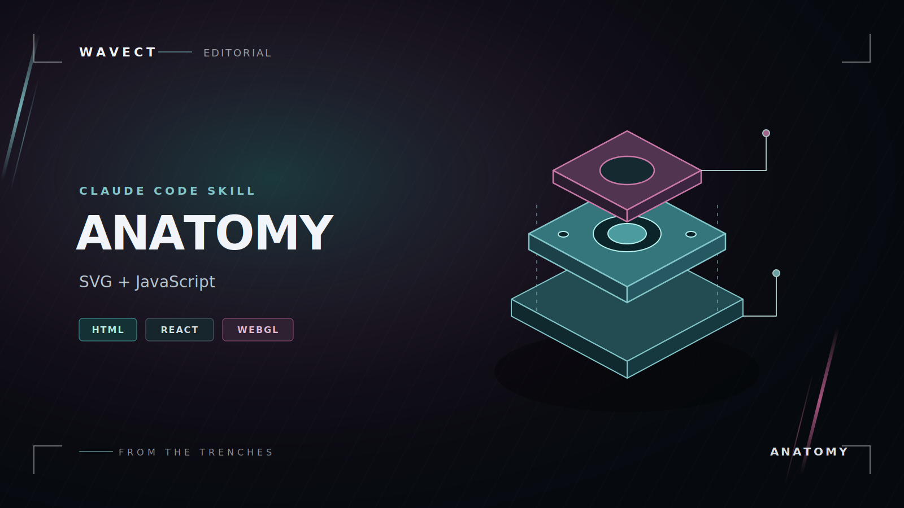
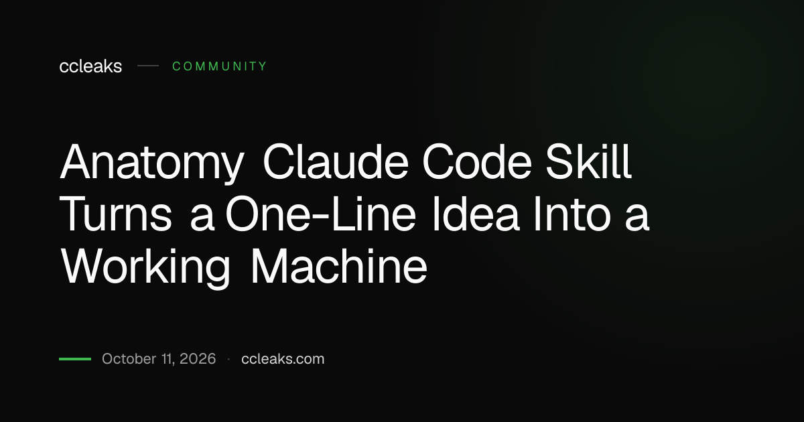

# Anatomy Skill for Interactive Technical Machine Illustrations

Anatomy Skill turns a technical idea into a working visual mechanism.
The Anatomy Agent Skill combines agent instructions with a drawing kit and verification tools.
The wheresryan22 anatomy project is maintained by Ryan and its contributor community.

An anatomy claude code skill workflow starts with the behavior a figure should explain.
For users searching anatomy skill claude, the goal is a precise object whose moving parts reveal that behavior.
Deliverables can include SVG artwork, standalone HTML, or components for a React application.

[](https://anatomy-skill.github.io/Anatomy-Agent-Skill/)

## What it makes

Anatomy builds figures from geometry and a small state model.
Each control should change something meaningful, and each readout should follow that same model.

| Output | Useful when | What to review |
| --- | --- | --- |
| Static SVG | A document needs a scalable technical figure | Silhouette, depth, and legibility |
| Interactive HTML | Readers should test a mechanism in a browser | Controls, model state, and feedback |
| SVG with WebGL | A figure needs flowing or luminous effects | Camera alignment and fallback rendering |
| React components | A figure belongs inside an application | Component boundaries and client behavior |
| 3D mode | Rotation is necessary to explain the object | Visibility, ordering, and performance |

Choose the simplest output that communicates the mechanism.
A convincing physical relationship matters more than adding another visual effect.



## Usage

Describe the concept, relevant quantities, and behavior the reader should be able to test.
Specify the output format and visual theme so the result fits its destination.

An original prompt for an agent with Anatomy available:

```text
/anatomy explain a pressure relief valve that opens above 6 bar, interactive.
Let the reader increase inlet pressure and watch the valve lift.
Deliver standalone HTML in a light theme with a pressure readout.
```

Include units when a threshold or dimension matters.
Name the observable result rather than prescribing every decorative part.

- State what moves and what that motion means.
- Define the valid input range.
- Identify a reset state.
- Explain what the reader should learn from the interaction.

Anatomy Skill is most useful when the concept has a mechanism that can be built and inspected.
Treat the first generated figure as a draft to examine against the intended behavior.

## How it works

The workflow connects the explanation, geometry, presentation, and verification.
A change to the mechanism should remain consistent across all four.

1. Establish the concept and its real quantities.
2. Choose an object whose operation represents it.
3. Divide that object into parts with clear roles.
4. Build and project the geometry.
5. Connect inputs and readouts to model state.
6. Inspect the result in representative poses.

The ESM drawing core is [iso-kit.mjs](kit/iso-kit.mjs).
Its TypeScript counterpart is [iso-kit.ts](kit/iso-kit.ts).
The projection functions map spatial coordinates into the SVG drawing plane.

### File Structure

The supplied source selection includes the kit, reference guides, scripts, and regression fixtures.
The upstream example figures are not included in this selection.

- Geometry modules build reusable shapes and projected paths.
- Rendering helpers turn those paths into SVG markup.
- React adapters connect drawing components to an application.
- Browser tools inspect generated output and interactions.

The helper [inline-kit.mjs](scripts/inline-kit.mjs) reads kit modules as source for inclusion in standalone pages.
Keep the source layout intact so its relative module paths continue to resolve.

## Examples

A small geometry example helps separate the drawing API from agent prompting.
The following code creates SVG markup for a raised rectangular part.

Save this original example as `build-figure.mjs` at the repository root:

```javascript
import { slabOf, solidSvg, figureSvg } from './kit/iso-kit.mjs';

const projection = { origin: [180, 160], scale: 4 };
const paths = slabOf({ x: 0, y: 0, w: 18, d: 12, r: 2 }, 0, 4, projection);
console.log(figureSvg({
  width: 360, height: 240, label: 'Raised rectangular machine base',
  body: solidSvg(paths), standalone: true,
}));
```

The dimensions are illustrative model units.
This produces a static part, which can become the base of a larger mechanism.

Round-part geometry is implemented in [lathe.mjs](kit/lathe.mjs).
The module [tube.mjs](kit/tube.mjs) supplies geometry for pipes and cables.
Use these primitives to make connected parts agree in position and scale.

## Themes

The shared stylesheet is [iso.css](kit/iso.css).
It defines surface colors, shading, line tones, typography, and light-theme overrides.

- Review contrast at the size the figure will actually appear.
- Keep the readout distinguishable from secondary labels.
- Check whether small gaps remain visible in both themes.
- Use consistent visual treatment for parts with the same role.

A theme change should preserve the explanation.
Geometry and model behavior should not depend on the chosen background.



## What Makes This Different

The Anatomy Agent Skill explains through the operation of the object.
A useful figure lets the reader connect an input with a visible consequence.

Shader support is provided by [gl.mjs](kit/gl.mjs).
Its projection helpers allow shader effects to share the geometry's camera.
Use effects where they communicate a process such as heat, light, or flow.

The 3D runtime is [turn.mjs](kit/turn.mjs).
The associated builder is [turn-build.mjs](kit/turn-build.mjs).
This mode supports parts that change orientation in depth and remains beta functionality.

For application integration, [draw.tsx](kit/react/draw.tsx) supplies drawing components.
The client-side module [live.tsx](kit/react/live.tsx) provides interaction-related hooks.
Its motion helpers account for reduced-motion preferences and whether content is in view.

## Commands

The supplied tools expose Node-based command-line interfaces for inspecting generated output.
After saving the geometry example above, these commands write its SVG and capture two previews:

```bash
node build-figure.mjs > figure.svg
node scripts/capture.mjs figure.svg --out preview-desktop.png --width 1440
node scripts/capture.mjs figure.svg --out preview-mobile.png --width 390
```

Run them from the repository root in an environment with Node and Chrome or Chromium.
They create local output files when executed.
The browser capture tool is [capture.mjs](scripts/capture.mjs).

For interactive pages, [drive.mjs](scripts/drive.mjs) supports pointer actions, key presses, waits, and screenshots.
A screenshot records one state; scripted actions help inspect transitions between states.

## Requirements

The upstream project lists Node.js 20.10 or later for its kit and checking tools.
Browser verification requires Chrome or Chromium.
React output requires a compatible React environment; the upstream baseline is React 18 or later.

The core kit uses Node's built-in modules for its framework-free build workflow.
A generated React figure also depends on its host application's build configuration.

The geometry audit implementation is [audit.mjs](kit/audit.mjs).
Line-end checking is implemented by [lines.mjs](scripts/lines.mjs).
The browser-oriented 3D checker is [turn-check.mjs](scripts/turn-check.mjs).

Inspect both the geometry and the explanation.
Passing a structural check does not establish that the simulated concept is correct.

## Limits

Detailed figures require time for modeling, layout, and verification.
Dense scenes can be expensive to build and animate, especially when parts rotate in 3D.

- Prefer a mechanism with a clear causal relationship.
- Check touch-sized layouts as well as desktop views.
- Keep essential structure understandable without optional shader effects.
- Review motion behavior with reduced motion enabled.
- Verify numerical claims against the underlying model.

Anatomy focuses on technical objects and mechanisms.
Conventional data charts, anatomical portraits, and exact geographic maps need different approaches.

## Related Search Terms

Anatomy Skill, Anatomy Agent Skill, wheresryan22 anatomy, anatomy claude code skill, anatomy skill claude, agent-skill, open-source, svg, visualization, isometric, webgl, interactive, technical-illustration, javascript, react
